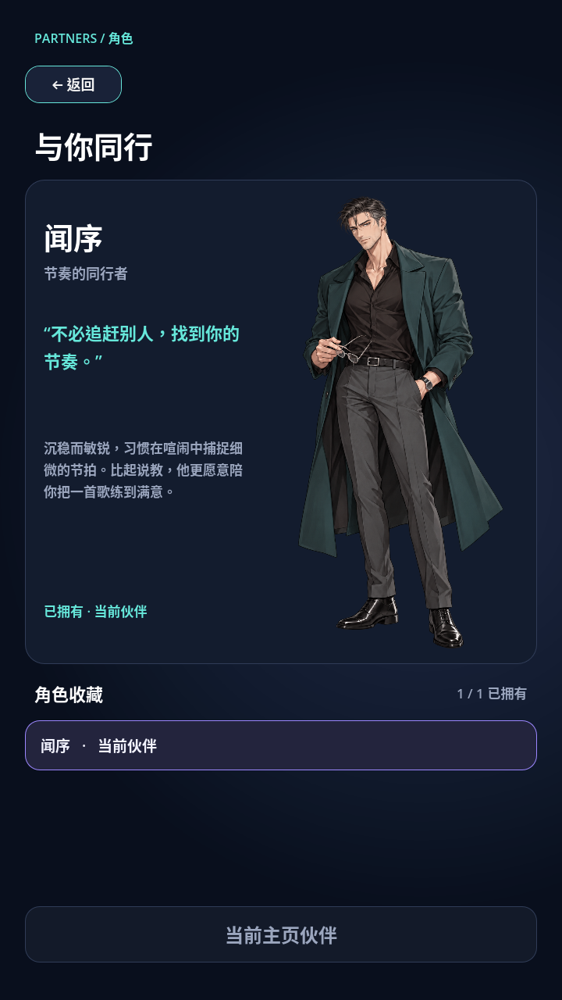
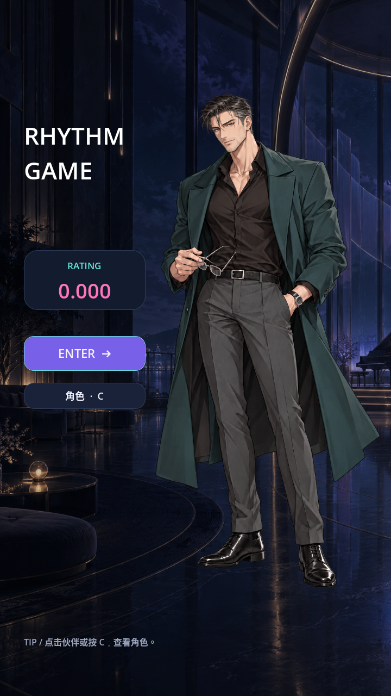
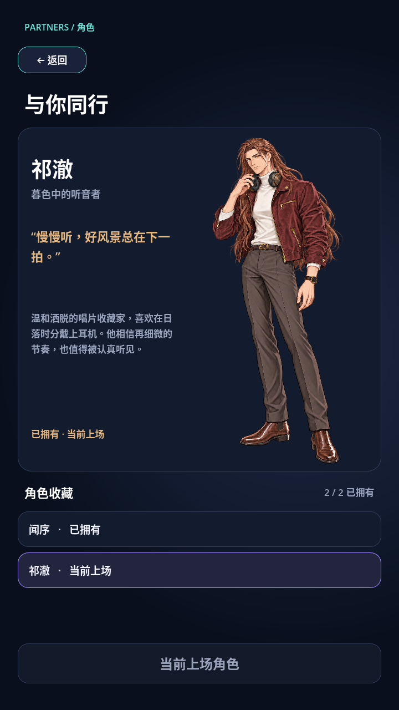

# 角色系统

目前有两位伙伴：**闻序**登录后自动获得；**祁澈**在 Leisure 达到满分 **1,000,000** 后获得。旧版本的拥有记录继续保留。
角色只用于伙伴展示，不修改分数、判定或 Rating。

祁澈正式立绘采用栗棕长发披散及腰、平静稍严肃的版本，保留酒红外套、米白高领衫和耳机。正式图片使用 `assets/characters/qiche_hd.png`，以新资源路径重新导入高清立绘，已有解锁和上场选择无需重新获取。
正式原图经 Real-ESRGAN 4 倍超分辨率处理，尺寸为 **4096 × 6144**（原图为 1024 × 1536，像素总量提升 16 倍），使用透明 RGBA PNG。Godot 保留完整尺寸并无损导入，在缩小显示时使用 mipmaps 过滤以避免高分辨率纹理出现锯齿。

## 在游戏中使用

- 在主页点击 Enter 下方的 **角色** 按钮、点击人物，或按 **C**，进入角色页。
- 角色页展示立绘、名字、称号、简介、台词和解锁说明。
- 下方收藏列表展示所有配置角色，以及“当前上场 / 已拥有 / 未解锁”状态。
- 已拥有的角色可设为上场角色；同一时间只有一个上场角色，未拥有的角色可以查看资料，但无法选择。
- 返回开始界面后，同步显示上场角色的立绘与专属背景；**Esc** 返回。
- 浏览角色资料不会改变上场角色，只有点击“设为上场角色”才会替换当前选择。
- 直接运行场景可以预览界面，没有登录时不会授予角色或保存选择。

## 添加新角色

1. 把透明 PNG 立绘放进 `assets/characters/`。
2. 在 `characters/catalog.json` 的数组中追加一个对象。数组顺序就是列表顺序。
3. 为角色使用独立且固定的 `id`。不要复用或更改已发布角色的 ID，否则存档无法正确关联。

以下是配置格式示例，**没有加入正式角色列表**：

```json
{
  "id": "new_partner",
  "name": "新角色名字",
  "title": "角色称号",
  "description": "角色简介，建议控制在约 100 字以内。",
  "quote": "角色的一句台词。",
  "portrait": "res://assets/characters/new_partner.png",
  "background": "res://assets/backgrounds/new_partner_background.png",
  "accent": "#FFA66E",
  "unlock": {
	"type": "manual",
	"description": "完成指定挑战后获得"
  }
}
```

`id` 必须唯一。立绘支持 Godot 的 Texture2D 资源，推荐使用透明 PNG；缺失或无效的立绘显示“立绘待补充”。
`portrait` 和 `background` 分别指定该角色的立绘与开始界面背景。背景推荐竖屏、较暗的图片，保持白色游戏名和按钮清晰。未设置或资源无效时，背景会回退到默认夜景。

名字、称号、简介和台词建议保持简短，长文本会限制行数以保护页面布局。

### 登录赠送与奖励解锁

- `unlock.type` 为 `login`：每次登录自动检查并补发该角色，不会重复添加。
- `unlock.type` 为 `song_score`：按 `song_id` 对应歌曲的最高分检查 `score` 门槛，在结算和登录读取历史成绩后自动解锁。祁澈使用 `song_id: "leisure"`、`score: 1000000`，SSS+ 或 Full Combo 本身不等于满分。
- `unlock.type` 为 `manual`（或省略）：角色默认未解锁，需要在实际任务或奖励逻辑中调用解锁接口。
- `unlock.description` 是给玩家看的说明文字；实际条件由 `type`、`song_id` 和 `score` 决定。歌曲编号使用歌曲文件夹名。

满分结算会显示“新伙伴已获得 · 祁澈”，获得角色不会自动切换上场选择。在角色页选择祁澈并设为上场后，主页会显示他的立绘和黄昏听音室背景。
更新前已有 Leisure 满分云端纪录的账号，下次登录读取成绩后会补发；成绩上传失败时，本次满分也能在本地解锁。

奖励条件达成时：

```gdscript
const Partners = preload("res://partner_system.gd")

if Partners.unlock_character(get_tree(), "new_partner"):
	# 角色已经获得并保存，可以通知玩家。
	pass
```

也可用 `Partners.select_character(get_tree(), "new_partner")` 将已拥有角色设为上场角色。它会替换存档里的单个 `active` ID，其他角色的拥有状态不变。
不存在、未拥有或未登录时无法选择；重复解锁不会产生重复记录。
将 JSON 和立绘加入项目后，重新进入角色页即可读取新角色，不需要为每个角色新建场景。

## 存档与兼容

拥有列表及当前角色继续按账号保存在：

```text
user://partners_<账号ID的SHA256>.json
```

- 保留旧版本的 `owned` 和 `active`，以及其他已有字段。
- 账号切换时，不能使用上一账号的内存记录。
- 当前角色不存在或不再属于拥有列表时，回退到第一个可用的已拥有角色。
- 暂时不在当前配置中的拥有记录仍保留，避免移除角色配置时丢失历史解锁。
- 选择保存成功后才更新当前角色，文件通过临时文件替换写入。
- 不保存令牌或密码。

目前角色收藏与选择是**本地按账号存储**，没有新增云端角色表。换设备登录仍会收到所有登录赠送角色，并根据成功读取的云端歌曲最高分补发成绩奖励角色；手动奖励及当前选择尚不跨设备同步。尚未上传的本地满分解锁也不会同步到其他设备。

## 验证

```sh
godot --headless --editor --import --quit
godot --headless --audio-driver Dummy --script res://tests/test_characters.gd
godot --headless --audio-driver Dummy --script res://tests/test_partners.gd
godot --headless --audio-driver Dummy --script res://tests/test_score_rewards.gd
godot --headless --audio-driver Dummy --script res://tests/test_rating.gd
python3 tests/check_character_expansion.py
```

角色测试包含旧存档兼容、账号隔离、无效选择拦截、点击入口、C 快捷键、资料显示与返回主页。成绩奖励测试验证满分边界、指定歌曲、重复奖励、保存失败、历史纪录补发和角色/背景切换。
扩展验证脚本会在临时项目副本加入手动解锁的第二个角色，验证解锁、选择、重新登录及动态立绘；测试角色不会加入正式配置。

导出游戏时，在导出预设的非资源文件过滤中填写 `*.json`，以包含角色配置 `characters/catalog.json` 和歌曲包 JSON。

## 主页背景

开始界面从上场角色的 `background` 配置读取图片，附加轻微深色遮罩；背景不接收输入。闻序绑定原创夜景音乐厅 `assets/backgrounds/home_midnight_atrium.png`；祁澈绑定黄昏听音室 `assets/backgrounds/home_qiche_dusk.png`。

本功能作用于登录后的开始界面（含 Enter、Rating、角色按钮），邮箱和密码的登录页不变。

## 效果图








