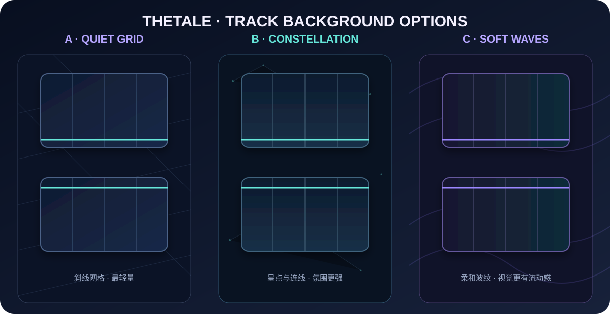

# 游戏轨道背景备选

这三版都只使用少量线条、圆点和渐变，适合直接作为 Godot 轨道背景：

- **A · Quiet Grid**：斜线网格，最简洁、性能开销最低。
- **B · Constellation**：暗色星点和连线，氛围更明显。
- **C · Soft Waves**：低对比度波纹，画面更有流动感。

当前只是预览，还没有替换游戏里的轨道。选定 A、B 或 C 后再应用。
